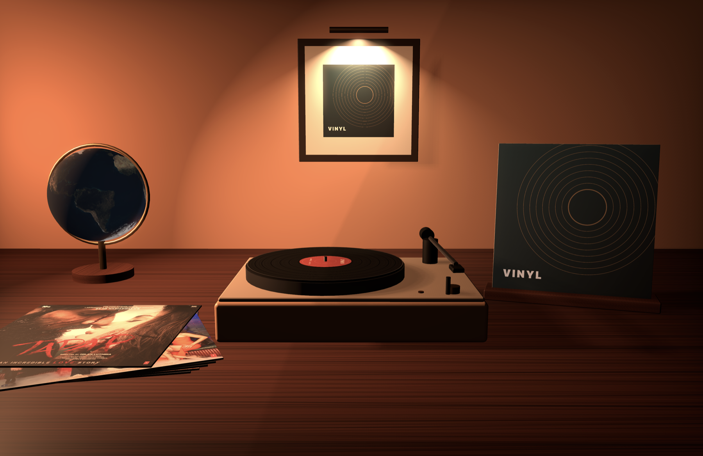

<div align="center">

# Vinyl

**Your Mac's desktop becomes a live record player.**




</div>

While Spotify or Apple Music plays, a record spins on your desktop with the album art on its label. When the song changes, the last record joins a stack of recently played covers. It is free and written from scratch in Swift. It is not affiliated with the commercial Vinyl for Mac app.

## What it does

- **Four scenes:** Lamplight (a night room with a desk globe), Deck (a turntable), Studio (a big sleeve) and Midnight (a floating record).
- **Transparent mode:** drop the scene and let the player sit on your own wallpaper.
- **Clickable:** hover for previous, play/pause and next. Click the record to play or pause.
- **Live info:** track, artist, album and a progress bar.
- **Light on your Mac:** the record stops spinning when you pause or in Low Power Mode.
- **Spotify and Apple Music,** with no account or API key. Works on every display and Space.

## Install

1. Press **⌘ Space**, type **Terminal**, press **Return**.
2. Paste these lines and press **Return**:

   ```bash
   git clone https://github.com/AkulxSharma/Vinyl.git
   cd Vinyl
   ./build.sh --install
   ```

3. Vinyl opens. Look for the record icon in the menu bar to switch scenes or quit.

If macOS asks to install developer tools, click **Install**, then paste the lines again. The first time, macOS asks whether Vinyl may control Spotify or Music. Click **OK** so it can read the current track.

## Privacy

Vinyl has no account and no analytics. If a player doesn't provide cover art, Vinyl looks it up from Spotify's public oEmbed endpoint or Apple's iTunes Search API. That sends the track ID, or the artist and album name.

## For developers

How it works and the project layout are in [docs/DEVELOPMENT.md](docs/DEVELOPMENT.md).

The Earth texture is `earth_atmos_2048.jpg` from the three.js examples (MIT), derived from NASA's Blue Marble imagery (public domain).

Free to use and change under the [MIT License](LICENSE). If you like it, give it a ⭐.
